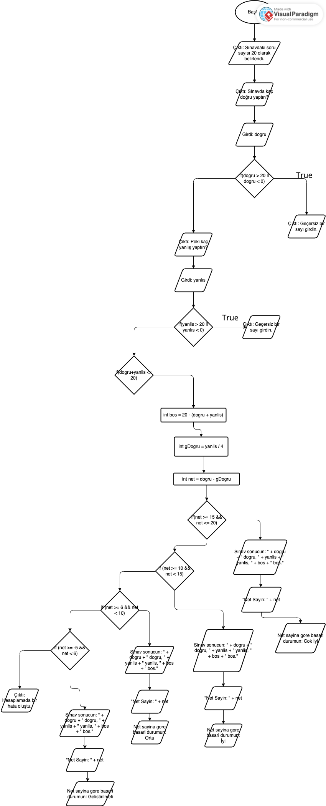

# Rapor

**Ad Soyad: Emir Ali Mayan**
**Numara: 740**

## 1. Problem Analizi
<!-- Problemi kendi cümlelerinizle yazın. -->
Bu kodun problemi 4 yanlışın bir doğruyu götürdüğü 20 soruluk bir deneme sınavında boş ve netin hesaplandığı, net sayısına göre, önceden belirlenen net değerlendirmelerini baz alarak değerlendirme yapmaktır.

## 2. Girdi - İşlem - Çıktı

**Girdiler:**
- dogru
- yanlıs
 
**İşlemler:**
- 4 yanlış nedeniyle kaybedilen doğruları bulma
- net hesaplama
- bos hesaplama


**Çıktılar:**
- Doğru, yanlış ve boş sayısı
-  net sayısı
-  net değerlendirmesi.

## 3. Matematiksel Formüller

- bos sayısı = 20 - (dogru sayısı + yanlıs sayısı)
- kaybedilen doğru = yanlıs sayısı / 4
- net sayısı = doğru sayısı - kaybedilen doğru sayısı


## 4. Sözde Kod (Pseudocode)

```
1. BAŞLAT
2. Sınavdaki soru sayısının 20 olduğunu kullanıcıya söyle.
3. Kullanıcının sınavdan kaç soruyu doğru yaptığını sor ve "dogru" degiskeninde sakla.
4. Eğer dogru 20'den buyuk veya 0'dan kucukse programı kapat, değilse devam et.
5. Kullanıcının kaç yanlış yaptığını "yanlıs" degiskeninde sakla.
6. Eğer yanlıs 20'den buyuk veya 0'dan kucukse programı kapat, değilse devam et.
7. Eğer dogru+yanlıs 20'den buyukse programı kapat, değilse devam et.
8. Boş sayısını, giden doğru sayısını ve net sayısını hesapla.
9. Eğer net 15-20 net arasındaysa doğru/yanlış/boş/net sayısını ver ve değerlendirmesinin Çok İyi olduğunu söyle
10. Eğer net 10-14 net arasındaysa doğru/yanlış/boş/net sayısını ver ve değerlendirmesinin İyi olduğunu söyle.
11. Eğer net 6-9 net arasındaysa doğru/yanlış/boş/net sayısını ver ve değerlendirmesinin Orta olduğunu söyle
12. Eğer net -5 - 5 net arasındaysa doğru/yanlış/boş/net sayısını ver ve değerlendirmesinin Geliştirilmeli olduğunu söyle
13. Eğer hiçbiri değilse hata kodu ile programdan çık.
14. BİTİR
```

## 5. Akış Şeması



## 6. Başarı Durumu Koşulları
<!-- Koşulları hangi sırayla ve hangi operatörlerle yazdığınızı, nedenini açıklayın. -->
Koşullarda sıra ile ilgili özel bir düşünme sergilemedim. İyiden kötüye olacak şekilde bütün değerlendirmeleri sıralayıp ona göre yazdım. Kullandığım operatörler ise: || yani "ya da", <= yani " küçük eşit", && yani "ve" gibi operatörler kullandım.

## 7. Test Sonuçları

| Doğru | Yanlış | Beklenen | Programın sonucu | Doğru mu? |
|---|---|---|---|---|
| 20 | 0 | Net 20, Çok iyi | 20 net, cok iyi | Doğru |
| 15 | 4 | Net 14, İyi | 14, iyi  | dogru|
| 10 | 8 | Net 8, Orta | 8, orta |dogru|
| 5 | 0 | Net 5, Geliştirilmeli | 5, gelistirilmeli | |
| 0 | 20 | Net -5, Geliştirilmeli | -5, gelistirilmeli | dogru |
| 10 | 10 | Net 7,5, Orta |8, orta |yanlış |
| 15 | 10 | Geçersiz giriş |gecersiz | dogru |
| 12 | 9 | Geçersiz giriş | gecersiz | dogru |
| -1 | 5 | Geçersiz giriş | gecersiz | dogru |
